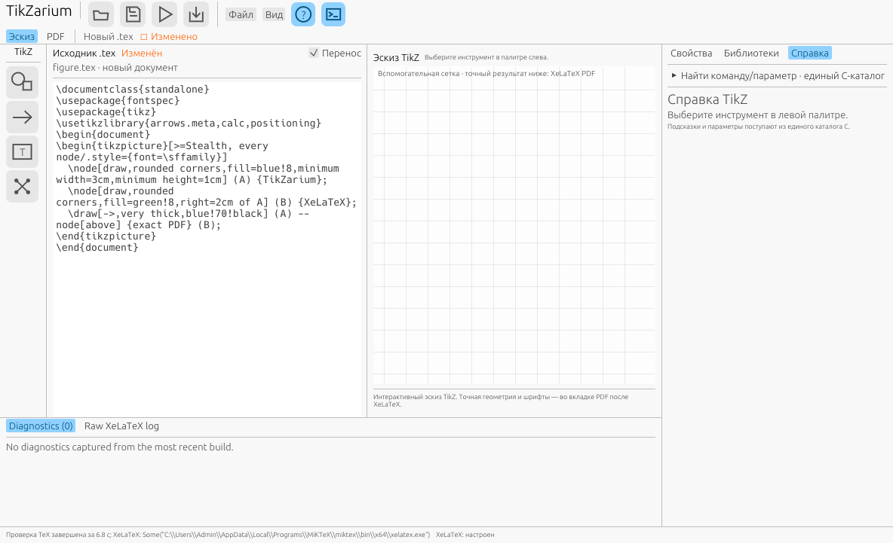
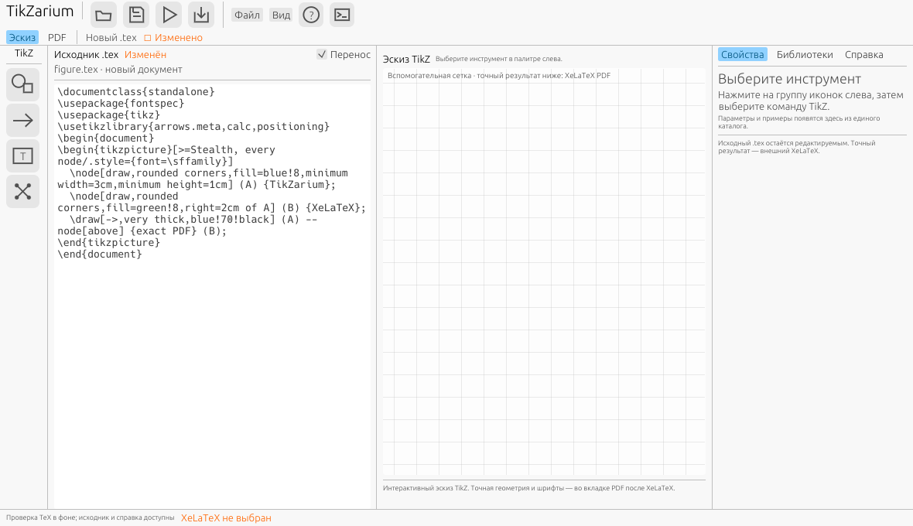
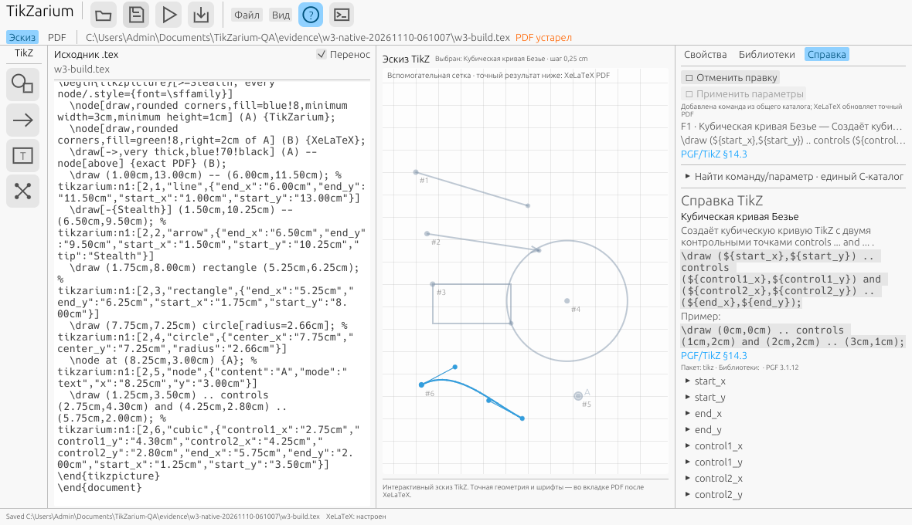
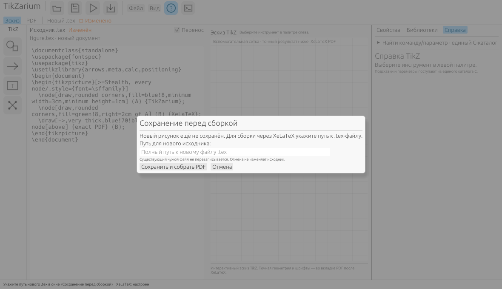
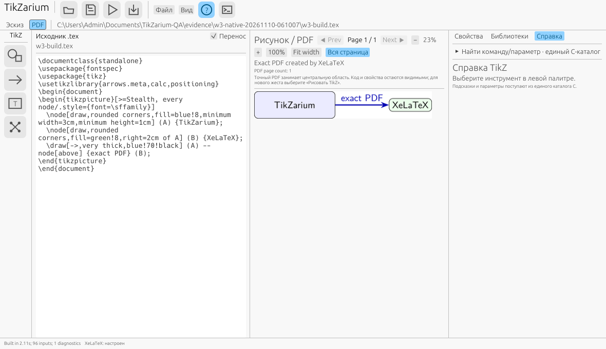

# TikZarium: критический аудит интерфейса — 10 ноября 2026

## Вердикт

**Текущий интерфейс ещё не соответствует повседневному редактору TikZ.** Он позволяет доказать отдельные технические операции, но заставляет пользователя разбираться в устройстве приложения, помнить скрытые режимы и читать служебную информацию вместо рисунка и кода. Косметическая смена темы этого не исправит. Первыми нужны полноценная подсветка TeX/TikZ, навигация по исходнику и ясный цикл «правка → сборка → результат».

Самая показательная проблема измерима: в шести созданных командах из проверенного `cubic.tex` **319 символов приходится на код и отступы, 696 — на служебные комментарии**, начиная с ` % tikzarium:n1:`. **68,6% этих строк — метаданные приложения.** Это доля символов в выбранных шести строках, не доля всего документа или измерение площади экрана. На снимке с включённым переносом метаданные занимают многочисленные визуальные строки и читаются с той же силой, что `\draw` и `\node`.

**Запрос владельца «код с подсветкой» принят как обязательный результат первого UX-релиза.** Выделение созданной строки, приглушение JSON-комментария и `.code_editor()` не выполняют это требование.

Релизная UX-ветка: [план UX-0…UX-4](../roadmap/UX_2026-11-10_RELEASE_PLAN_RU.md). Этот документ — анализ и требования, не заявление о внедрённых исправлениях.

## 1. Что действительно проверено

| Источник | Факт и граница применимости |
| --- | --- |
| Свежий репозиторий | Выполнен `git fetch origin --tags`; аудит `main=bd0b698503648f43a1db9d1810466ec5d1c18ecd`. Рабочая ветка `codex/ux-audit-20261110` |
| Публикации | [GitHub releases API](https://api.github.com/repos/i-shutov/tikzarium/releases?per_page=5) вернул `[]`; после fetch список Git-тегов пуст. Опубликованный релиз для скачивания не найден. Историческое упоминание Linux RC в README не равно доступному GitHub Release |
| Имеющийся Windows candidate | Локально есть portable от `488a9687`, [manifest кандидата](../release/candidates/windows10-x64-main-488a9687.json). Повторно проверен EXE SHA256 `f8f534d36d5fd26fcef5f8c47094871bc81882c3cfbb25411ad46975da3915a5`. Это ранее скачанный CI candidate, не свежий stable и не новый запуск в этом аудите |
| Визуальные материалы | Просмотрены 8 оригинальных клиентских PNG 1180×680: startup, F1, palette, rectangle, cubic, PDF, Save & Build, diagnostics. Копии и исходный TEX сохранены в [evidence manifest](assets/2026-11-10-ux-audit/manifest.json); каждый SHA проверен по исходному `ARCHIVE-SHA256.txt` |
| Происхождение снимков | Историческая локальная W3-контрольная точка: source `57cb62e4b70f896eb48978da4252ec1fede6c26a`, EXE `2ad442eeec9fe2757331cfd1d0fd75cac0d5a28db6b754caf19346425bc67522`. Это **не** финальный portable `f8f534…`. `git diff 57cb62e4 bd0b698 -- crates Cargo.toml Cargo.lock` пуст: код приложения и зависимости в изученном main те же, но бинарную идентичность это не доказывает |
| Живое окно | После двух тайм-аутов Sky по уточнению владельца прочитан [отчёт PR #157 о Default desktop](https://github.com/i-shutov/tikzarium/blob/b8eb2ff70c830371d6b02524eb42628402c39d1b/docs/WINDOWS_10_W3_CODEX_DESKTOP_CONTEXT_RU.md). Внешний worker подтвердил `WinSta0/Default`, Admin, session 2 WTS Active. Новый audit-owned PID 10572 / HWND 459002, EXE `2ad442…`, клиент 1184×721, 96 DPI. Получены живые оригиналы startup/F1/Libraries/Build/Cancel; чужие окна не снимались. Время задач, IME, screen reader и другие DPI **NOT_RUN** |
| Release scope | [Актуальный W0–W4](../docs/WINDOWS_1_0_RELEASE_CONTROL_RU.md): 1.0 — Windows10 x64, 96 DPI; 120/192 DPI отложены. Поздняя независимая приёмка W3-96 описана [отдельным актом](../docs/W3_WIN10_20261110_INDEPENDENT_ORIGINAL_REVIEW_RU.md); она не приписывается историческим снимкам этого аудита. Stable GO из UX-обзора не следует |

Выводы ниже основаны на видимом интерфейсе и конкретном коде. Предположения о затратах пользователя и целевые улучшения обозначены отдельно. Контраст не измерялся инструментально; утверждать соответствие или несоответствие стандарту по этим картинкам нельзя.

### Дополнение после живого осмотра через внешний worker

Повторно использованы native foreground/client-capture/pointer функции репозитория из одного разрешённого внешнего процесса. Первое измерение остановилось на `BLOCKED_WINDOW_OFF_SCREEN`; hosted-only `FitHostedWindow` также отказал на этой машине. Новое собственное тестовое окно отдельно размещено внутри экрана (1200×760 при позиции 20,20), после чего **неизменённые** проверки PID/session/Default/foreground/границ и полный PrintWindow capture прошли. Hosted environment не подделывался, защитные проверки не отключались. Подробности в [transcript](assets/2026-11-10-ux-audit/worker-transcript.txt).



На новом запуске подтверждены одноцветный source, отсутствие gutter, смешанный язык и внутреннее `Some(path)` в статусе TeX. Восстановились открытые Help/Diagnostics — это сохранённые preferences, **не чистый профиль первого запуска**. Два F1 перевели Help в Properties; первый снимок после F1 внешне не изменился, поэтому он не считается самостоятельным доказательством перехода. Mouse click открыл вкладку Libraries. Раскрытие списка библиотек в последующих попытках визуально не подтверждено; новых выводов о его содержимом не делаем.

`Ctrl+Enter` показал [живой Save & Build](assets/2026-11-10-ux-audit/live-build-dialog.png) с единственным полем полного пути, `Escape` закрыл его; [статус сообщает «исходник не изменён»](assets/2026-11-10-ux-audit/live-build-cancelled.png). Это проверка интерфейса отмены, не новый побайтовый Save/Undo тест. Сборка/PDF и шесть жестов в этом дополнительном прогоне не выполнялись. Worker завершён, прежние пользовательские процессы не закрывались.

## 2. Доказательства визуальной проблемы

### Первый запуск: интерфейс не объясняет следующий шаг



В исходнике уже есть демонстрационная схема, но центр пуст. Справа большой блок «Выберите инструмент». Чтобы увидеть результат, нужно понять смысл треугольной кнопки, дождаться проверки TeX, пройти сохранение и найти PDF. Пользователь может ошибочно решить, что импортированный рисунок не прочитан. Это риск понимания, а не доказанный сбой импорта.

### Шесть жестов: машинный текст вытесняет язык рисунка



Слева нет ни цветового разделения команд/комментариев/значений, ни номеров строк. Справа одновременно видны краткая F1-сводка, шаблон команды, ссылка на manual, ещё одна справочная карточка, пример и перечень параметров. Часть информации повторяется, а имя вроде `control1_x` требует расшифровки.

### Первая сборка: ручной путь вместо удобного выбора



Диалог теперь видим и позволяет отмену — это полезное исправление. Но обычная первая сборка всё ещё требует вручную указать путь. Существование native picker в другом меню не делает этот сценарий удобным.

### Результат PDF: технические подписи сильнее содержимого



Маленький рисунок сам по себе не дефект: PDF страницы действительно бывают широкими и низкими. Проблема в распределении внимания: несколько строк заголовков и пояснений, смешанные `Page`, `Fit width`, `Вся страница`, пустующая справка и постоянно видимые инструменты рисования в режиме PDF.

## 3. Реестр проблем

Приоритеты: **P1** — систематическое препятствие основному сценарию, исправлять в ближайшей UX-поставке; **P2** — существенное ухудшение обнаружимости/плотности/ясности. **P0 (утрата данных, опасное действие) этим аудитом не доказан.** Серьёзность здесь экспертная, а не результат измерений на группе пользователей.

| ID | Приоритет | Подтверждённая проблема | Последствие и требуемый результат |
| --- | --- | --- | --- |
| UX-F01 | P1 | В `main.rs:303–345`, `show_source_text_edit`, `LayoutJob::simple` задаёт один цвет всему буферу | Код трудно сканировать. Нужны отдельные токены TeX/TikZ, темы и отличимые комментарии; требования в §5 |
| UX-F02 | P1 | `tikz_authoring.rs:184–191` добавляет длинный JSON ownership; `source_soft_wrap=true` в `ui_theme.rs`; 68,6% измеренных строк — метаданные | После нескольких фигур код превращается в стену текста. Приглушить служебные комментарии с проверенным контрастом; дать удобный выбор переноса; сохранять точные байты |
| UX-F03 | P1 | В `show_source_editor` нет gutter, Find/Replace или перехода к строке; существующий jump вызывается действиями приложения | Длинный исходник неудобно читать и чинить по номеру ошибки. Добавить номера **физических** строк, текущую строку, Find/Replace и Go to line с сохранением корректных Unicode-offsets |
| UX-F04 | P1 | Startup показывает код готовой схемы и пустую сетку. `show_pdf_canvas` разделяет provisional guide и точный PDF, исходные произвольные команды не становятся этим эскизом | Пользователь должен сам открыть внутреннюю модель приложения. Нужны видимые состояния «Эскиз новых объектов» / «PDF исходника» и явное первое действие «Собрать PDF»; нельзя обещать универсальное визуальное редактирование |
| UX-F05 | P1 | `build_save_dialog.rs:controls` содержит только поле полного пути, Save & Build и Cancel | Первый полезный результат требует знания файловой системы. Добавить «Выбрать…», разумное предлагаемое имя и отдельный ручной путь как fallback; не ослаблять overwrite guard |
| UX-F06 | P2 | `studio_ui.rs:show_group_rail_observed` → плавающая палитра → инструмент: минимум два выбора; снимок tools показывает наложение палитры на центр | Основные шесть инструментов спрятаны за абстрактными группами. Сделать базовые инструменты непосредственно доступными, группы оставить расширениям; закрепляемая палитра не должна закрывать объект |
| UX-F07 | P1 | `tikz_canvas.rs:parameter_control` выводит `p.id` и абзац справки под каждым полем; `show_inspector` повторяет Apply ниже, а action bar закреплён сверху | Полезные поля тонут в пояснениях. Русские короткие подписи + техническое имя в подробностях, единицы у значения, компактные группы, один Apply и явный dirty draft |
| UX-F08 | P2 | F1-summary в action bar и `studio_ui::show_context_help` повторяют syntax/manual; снимок cubic это подтверждает | Площадь справа расходуется повторно. Одна карточка контекста; пример, ограничения, source/version — по раскрытию; подробности остаются доступны офлайн |
| UX-F09 | P1 | `icon_button` рисует интерактивную область, а Open/Build/Export в `show_studio_toolbar` отсекают действие последующим `&& ready`/проверкой PDF | Вид доступного действия может не соответствовать возможности выполнить его. Например, Export без PDF выглядит кнопкой, но обработчик не экспортирует. Нужны настоящий disabled-state и понятная причина; не только tooltip |
| UX-F10 | P2 | Смешение русского, английского и технических состояний: `Page`, `Next`, `Diagnostics`, `Raw XeLaTeX log`, `Some(...)` в статусе завершения discovery (`poll_tex_discovery`) | Для выполнения задачи приходится переводить терминологию и читать внутренние данные. Согласованный русский словарь; пути и debug-представления — в подробностях |
| UX-F11 | P1 | Несколько состояний живут раздельно: dirty source, pending draft, stale PDF, discovery, build, raw diagnostics. Общая `self.status: String` обслуживает разные события | Пользователь не получает одного устойчивого ответа «какой результат сейчас передо мной». Ввести видимые раздельные состояния документа/сборки/PDF с ревизиями; stale нельзя скрывать после ошибки |
| UX-F12 | P2 | Моношрифт фиксирован 14 pt в `ui_theme.rs`; исходник и инспектор имеют минимумы/максимумы, narrow flag у rail фактически игнорируется (`let _ = narrow`) | Читаемость нельзя настроить независимо, адаптация неполная. Размер кода, сброс раскладки, явные focus views и проверяемое сжатие. **Это риск на узких/HiDPI экранах, не результат нового DPI-теста** |
| UX-F13 | P2 | Кастомные иконки в `icon_button` реализованы через `allocate_exact_size`/paint/hover без явных семантических имён кнопок в этой функции | Есть риск клавиатурной/assistive доступности. Нужны семантические роли/имена, видимый focus и реальный Tab/Enter тест. Не утверждаем, что screen reader заведомо не работает: такого прогона не было |
| UX-F14 | P1, процесс | В AI roadmap UX впервые явно фигурирует в AT9 после предметных адаптеров; старые roadmap-секции содержат несколько отменённых «current» правил | Неудобная оболочка масштабируется до 88 случаев до собственной приёмки. UX становится отдельной ранней веткой, общий контракт editor/inspector нужен до массового S3, статусные сводки должны иметь одну актуальную точку |

Ссылки на исходники фиксируются на проверенном SHA: [main.rs](https://github.com/i-shutov/tikzarium/blob/bd0b698503648f43a1db9d1810466ec5d1c18ecd/crates/tikzarium-app/src/main.rs), [studio_ui.rs](https://github.com/i-shutov/tikzarium/blob/bd0b698503648f43a1db9d1810466ec5d1c18ecd/crates/tikzarium-app/src/studio_ui.rs), [tikz_canvas.rs](https://github.com/i-shutov/tikzarium/blob/bd0b698503648f43a1db9d1810466ec5d1c18ecd/crates/tikzarium-app/src/tikz_canvas.rs), [ui_theme.rs](https://github.com/i-shutov/tikzarium/blob/bd0b698503648f43a1db9d1810466ec5d1c18ecd/crates/tikzarium-app/src/ui_theme.rs), [build_save_dialog.rs](https://github.com/i-shutov/tikzarium/blob/bd0b698503648f43a1db9d1810466ec5d1c18ecd/crates/tikzarium-app/src/build_save_dialog.rs).

## 4. Что нельзя ошибочно назвать отсутствующим

Уже есть редактируемый исходник рядом с рисунком, ручной resize, выключаемый перенос, Undo, сохранение/открытие, выделение созданной команды, jump по диагностике текущего файла, русский F1, переключение эскиз/PDF, Fit width/whole page, last-good/stale, темы и сохранение preferences. Серьёзный UX-долг не отменяет эту работу.

Нельзя «исправить» интерфейс удалением исходника, скрытой переписью ownership, запуском недоверенного TeX для автоматического предпросмотра или обещанием точного редактирования любого PDF. Русская клавиатура не доказывает IME; hosted GUI не доказывает физическую Windows10-приёмку.

## 5. Что означает обязательная подсветка кода

**Место:** настоящий редактируемый `.tex`/`.tikz` в Studio и source focus, а не read-only копия, скриншот или только `ui.code()` в Help.

Минимальные категории: управляющие последовательности (`\draw`, `\node`, пользовательские `\macro`), комментарии, группы `{}`, опции `[]`, числа/единицы, TikZ-операторы (`--`, `..`, `|-`, `-|`), имена окружений и математические разделители в поддержанном лексическом контексте. Распознанные ключи TikZ/PGF могут получать дополнительный стиль из общего каталога. Неизвестная команда не становится ошибкой только потому, что её нет в каталоге. Это **лексическая подсветка**, не новый TeX interpreter.

```tex
% Комментарий пользователя: сохранить кириллицу и CRLF
\begin{tikzpicture}[>=Stealth]
  \draw[->, blue, line width=0.8pt] (0,0) -- (2,1);
  \node[above] at (2,1) {$E=mc^2$};
  \myMacro{Текст с \% и \{скобкой\}} % неизвестный макрос разрешён
\end{tikzpicture}
```

Этот блок показывает тестовый материал; подсветка Markdown-просмотрщика не является реализацией подсветки TikZarium.

Требуемый контракт реализации:

- Один исходный буфер остаётся авторитетным. `LayoutJob.text.as_bytes()` равен входным байтам, секции используют валидные UTF-8 boundaries. Никакой нормализации CRLF, отступов, Unicode или содержимого комментариев ради цвета.
- Учитывать escaped percent, `\\` перед `%`, `\verb`/verbatim в заявленной области поддержки, незавершённый ввод, многострочный math и произвольные макросы. При `\catcode`/неподдержанном контексте — консервативный plain text; цвет не подтверждает корректность TeX.
- Подсветка синтаксиса, selection, текущая строка, найденный текст и diagnostic markers — независимые слои. После GUI-патча сохраняются правильные caret, Undo и переход к команде.
- Токены кэшируются по ревизии исходника; оформление — отдельно по теме, шрифту и wrap width. Не выполнять новый полный лексический проход на каждом idle-кадре. Проверить стоимость и layout, а не только lexer.
- Все четыре имеющиеся темы получают проверенную палитру; текст не должен становиться нечитаемым при selection или приглушении metadata. Цвет дополняется позиционными маркерами/подчёркиванием для ошибок.
- В UX-1 не вырезать и не сворачивать metadata внутри редактируемого буфера. Folding требует отдельного отображения source↔view и проверки copy/paste, navigation, Undo; без этого «красивый код» сломает source integrity.

## 6. Уже начатая UX-работа и её пределы

[Draft PR #128](https://github.com/i-shutov/tikzarium/pull/128), head `2d27906b957cb343f9d0ee38d77d3cddc4783a0b`, ветка `ux/source-metadata-inspector-20261107`, уже предлагает отдельный `source_presentation.rs`, приглушение `% tikzarium:n1:`, default no-wrap для новых preferences, компактные параметры и устранение второго Apply. GitHub на момент проверки сообщает `mergeable=false`, `mergeable_state=dirty`.

Это полезная заготовка, **не принятое исправление main** и **не полноценная подсветка**: PR ищет marker строковым `find`, остальные токены не различает. Простое изменение default wrap снимает часть вертикального шума ценой горизонтального скролла; задача читабельности на этом не закончена. Переносить только после сверки с актуальным editor/Undo fence и повторной приёмки. Проверить ложный marker в пользовательском тексте и контраст blend-палитры. Существующие preferences сохранять.

Свежие post-1.0 PR #146/#148/#149/#151 разрабатывают scientific workflow, #165 — AT0 intake. Они не исследованы здесь как готовые интерфейсы и не заменяют исправления main. Их будущие inspector/help должны использовать общий UX-контракт; повторный параллельный редактор не нужен.

## 7. Критика роадмэпа и решение по последовательности

В [AI roadmap](../roadmap/AI_TIKZ_SKILLS_2026-11-10_SUPPORT_ROADMAP.md) хорошо заданы полнота и source-safe предметные правки. Но если доводить UX только в AT9, десятки адаптеров закрепят нынешние неудачные поля, помощь, состояния и навигацию. Это повышает стоимость исправления каждого следующего экрана.

Нужно различать две оси готовности: **доказано, что инструмент работает**, и **доказано, что пользователь находит и выполняет задачу**. Число PNG, зелёный CI и exit 0 не измеряют поиск команды, понятность ошибки или первое сохранение. Для UX нужны короткие задачи без инструктора, количество неверных действий и время до результата. Цели и размер пилота заданы в релизном плане; текущих результатов этих измерений нет.

Последовательность: baseline → читаемый редактор → ясная рабочая область и цикл сборки → масштабирование/HiDPI/88-case integration. Инвентаризация AT0 и core-адаптеры могут идти отдельно; массовое принятие GUI-S3 опирается на новый редактор и inspector, а не откладывает их до финала. Заморозка 1.0 и существующие W2b/W4 не переписываются этим отчётом.

## 8. Критерий честного завершения аудита

Аудит выполнен по коду, архивным оригиналам и ограниченному новому живому осмотру через внешний worker; доказательства связаны хешами, UX-ветка записана. Исправления приложения, полная повторная физическая приёмка, тесты производительности, user study и стабильный релиз **не выполнены** в этой задаче. Следующая реализационная поставка обязана содержать работающую синтаксическую подсветку и её source-integrity проверки, а не очередной документ о будущем редакторе.
