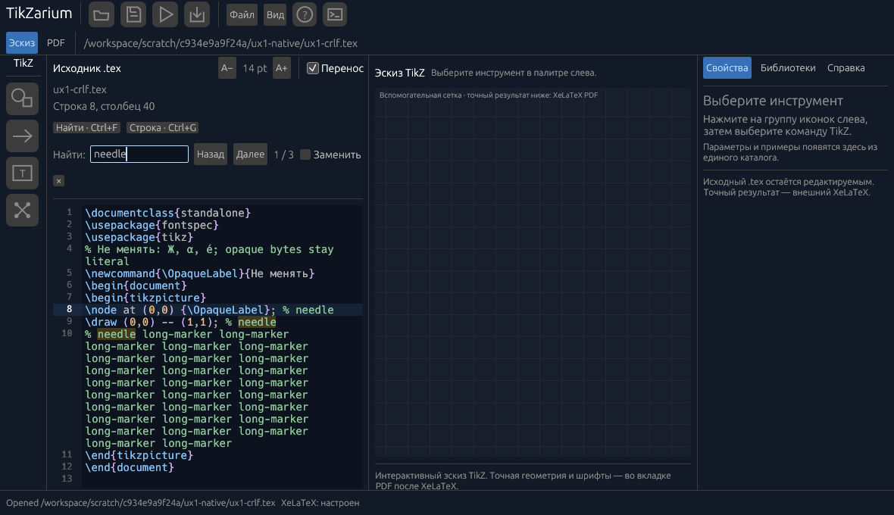
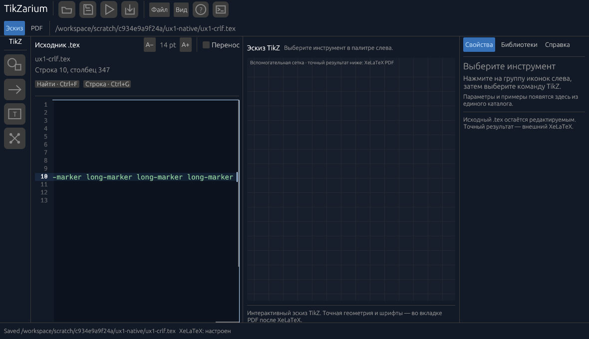
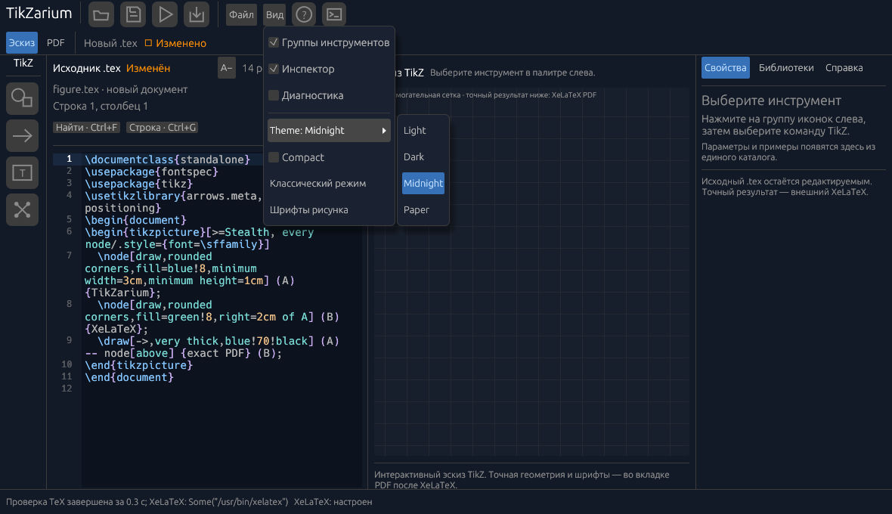

# UX1 — implementation and evidence (11 ноября 2026)

## Результат

UX1 опубликован в [PR #167](https://github.com/i-shutov/tikzarium/pull/167), исходный implementation commit `e8a3410cb65f3bda2fd20b4050de3e169454c100`: навигация по исходнику, подсветка поиска, буквальная замена, переход к строке, нативный Undo/Redo, номера физических строк, перенос/горизонтальная прокрутка и интеграция с внешними переходами редактора. Лексер распознаёт TeX-контекст и принадлежащие редактору метаданные, сохраняя непрозрачный пользовательский исходник.

Финальный code review не выявил оставшихся программных блокеров. Это заключение относится к проверенному рабочему дереву и переданным evidence, но не заменяет внешнюю Windows-приёмку или performance gate.

## Проверки кода

- `source_editor`: 9 тестов; `source_highlight`: 17 тестов.
- Итоговый полный workspace после startup-theme fix: **432 passed, 0 failed, 2 ignored**; manual CPU benchmark запущен отдельно в release. [Исходный финальный лог](assets/2026-11-11-ux1/workspace-tests-system-theme.log). Первоначальный прогон 431 теста сохранён отдельным исходным логом и отмечен в manifest.
- `cargo fmt --all --check`, `cargo build --locked -p tikzarium-app` и `cargo clippy --locked --workspace --all-targets -- -D warnings` проходят на итоговом срезе.
- Исправление меню темы использует `menu_button`, чтобы открытие подменю не закрывало родительское меню «Вид». Прошли 6 тестов темы, включая 8 pointer-путей и отдельную регрессию первого системного сообщения о теме. После исправления меню все четыре темы выбраны в настоящем Studio, исходный `.tex` после сохранения побайтово совпал с `examples/quickstart.tex`; последующая startup-регрессия и её исправление описаны отдельно ниже.
- Последний просмотр девяти event-тестов подтвердил сценарии Find/GoToLine, Enter в том же кадре, IME preedit/commit, Escape/focus, ReplaceAll с одним Undo/Redo, смену документа и сброс устаревшего preview, Unicode/CRLF, перенос строк и горизонтальную прокрутку с фиксированным gutter.

## Реальная Linux CUA-проверка

Проверка проведена на native Linux-окне **1180×680**. Зафиксированные исходные PNG и сохранённый исходник относятся к app tree `7d0301df524decdc0e1a5f156e5ff9e7b4787b7f` и исполняемому файлу SHA-256 `c9faee014266b495ebd9006116a11b607fb46d28cd3e5874f0de25e21ac3456b`.

На этом бинарном файле были фактически выполнены:

- Find показал три совпадения.
- Literal ReplaceAll заменил `needle` на `Ж$1\raw`; `$1` и обратная косая черта остались обычным текстом.
- Native Save сохранил Unicode и исходные окончания строк: 12 CRLF, 0 одиночных LF.
- Один Ctrl+Z полностью восстановил исходник; Ctrl+Shift+Z вернул точный результат замены.
- Go to line перешёл к строке 10.
- При отключённом переносе горизонтальный переход к концу оставил gutter на месте; переход к строке 1 снова показал её текст.

После обнаружения и исправления меню выполнен отдельный native проход четырёх тем на app tree **`2c85223f58b0b954de8655a5f5cf63515d0e4c39`**, binary SHA-256 **`3c2991c58812548889b596a20e41f04e82f2021f7fadb0aecb693994c1317b70`**. Между двумя app trees изменился только `ui_theme.rs`; editor/lexer/navigation остаются теми же source blobs. Сценарии и снимки двух запусков явно разделены в [manifest](assets/2026-11-11-ux1/manifest.json); они предшествуют startup-fix и не названы физической Windows-приёмкой.

Исходные evidence расположены в `assets/2026-11-11-ux1/`: `native/01-startup.png`, `native/02-find-highlight.png`, `native/03-replace-preview.png`, `native/04-replace-applied.png`, `native/05-one-undo-restored.png`, `native/06-goto-wrapped-line.png`, `native/07-fixed-gutter-horizontal.png`, `native/08-navigation-restored.png`, `native/replace-all-saved.tex`, `native/undo-restored.tex`, `native/redo-saved.tex`.

## Лексер и производительность

Лексер и представление исходника кэшируют токены отдельно от геометрии текста. Неизменившийся кадр переиспользует `Arc<Galley>`; invalidation учитывает источник, стиль/ширину, DPI и witness egui font cache. В локальном release CPU-only замере стабильный idle galley занял медианно **0,022 мс для 10 тыс. строк** и **0,489 мс для 100 тыс. строк**. Первый ввод после idle составил один замер **49,9 мс** и **803,8 мс** соответственно. Для 100 тыс. строк повторное редактирование стресс-фикстуры заняло медианно **1,553 с** (три измерения: 1,361–2,006 с).

**G3 и отзывчивость 100 тыс. строк: NOT_ACCEPTED.** Измерялись CPU lexer/egui layout операции без native input dispatch, GPU/renderer, compositor и видимого кадра; частота/загрузка shared runner не закреплялись. Повторяющиеся строки максимизируют reuse paragraph cache; ownership marker тоже повторяется. Количество повторов мало для оценки p95, а измерение не представляет уникальный пользовательский документ. Данные честно показывают низкую цену idle cache и сохраняющийся высокий риск полного relayout при редактировании большого файла, но не доказывают приемлемую задержку ввода.

[Первичный отчёт замеров](assets/2026-11-11-ux1/benchmark-report.json) и [исходный release лог](assets/2026-11-11-ux1/release-benchmark.log) сохранены рядом. Полный файл содержит профили, повторности, диапазоны, fixture hashes и ограничения эксперимента.

Дополнительный [диагностический эксперимент G3](assets/2026-11-11-ux1/g3/REPORT.md) сравнил тот же production cache с одноцветным layout на повторяющихся и уникальных строках. На 100k/8 MB после idle даже одноцветный вариант занял 2,8–3,8 с в двух локальных сериях. Найдены полный hash/split LayoutJob, удаление внутренних paragraph cache entries и глубокое копирование геометрии строк. Отключение подсветки не закрывает проблему. Следующий отдельный этап — кэш производной геометрии абзацев и пересчёт изменённой области с сохранением единственного source buffer, native TextEdit/Undo/IME и ограничением памяти. Это предложение, а не уже проверенная incremental-реализация; исходный harness, snapshot, metadata и raw logs сохранены рядом с отчётом.

## Исправления по review

Четыре исходные находки независимого ревью закрыты: gutter остаётся неподвижным при горизонтальной прокрутке; первый результат Find выбирается один раз при query+Enter в одном кадре; устаревший preview сразу отменяется после изменения source; переход из диагностики синхронизирует строку/столбец и прокрутку. Дополнительно исправлены фон поиска, отсутствующие glyphs кнопок поиска, IME Enter/Commit и дорогое копирование разметки на idle. Дополнительный final review не нашёл программных blockers. Preview намеренно сообщает число замен; применение всё равно проверяет точные исходные байты и revision.

## Первый hosted GUI прогон и исправление сценариев

На implementation commit `e8a3410` первый прогон обнаружил две устаревшие координаты в проверочных сценариях. Изменение исходника приложения не потребовалось; app tree остаётся `2c85223f58b0b954de8655a5f5cf63515d0e4c39`.

- [Bootstrap run 42981807266](https://github.com/i-shutov/tikzarium/actions/runs/42981807266), artifact `13837373986`: исходные PNG 04/05 показывают, что старый клик `(175,178)` открывает новое поле Go to line. Последующий Ctrl+A/C копирует это поле вместо исходника. Проверка правильно остановилась, но её сообщение о несовпадении source bytes само по себе не доказывает порчу TeX. Сценарий теперь использует `(175,268)`, где ранее в том же запуске дважды прошла точная clipboard-проверка исходника. ZIP SHA-256: `e4d93baf9a4c2219313eb42f5c989caf3aa911cf8d1f0098228ca4ede7e1118c`.
- [I61 run 42981807388](https://github.com/i-shutov/tikzarium/actions/runs/42981807388), artifact `13837623958`: автоматическая часть шести инструментов, Inspector Apply, Undo, Save/Open и external PDF прошла. N2 Connect/Disconnect/Undo и CRLF/Open/Save также прошли, а N3 остановился на повторной установке caret. PNG `n2-evidence/17-n3-prefix-in-source-editor.png` показывает импорт в пятой строке около y=295; старый y=239 попадает в `\\documentclass{standalone}`. Реально скопированы четыре символа `tand`, а не `arro`. Вместо новой координаты строки сценарий повторяет уже проверенную последовательность Ctrl+Home, четыре Down, Home; sentinel и точная проверка `arro` сохранены. ZIP SHA-256: `60409463bb3bf30267b4b697123c7497b91f88427cc90d6fbca9c24031e60f7c`.
- Точки фокуса исходника в R1 dirty-close и R3 native-picker перенесены с `(130,209)` на `(130,260)` по той же фактически просмотренной раскладке. Это адаптация сценариев, а не утверждение об успешном повторном выполнении R1/R3.

Root и независимый Sol reviewer просмотрели оригинальные снимки и diff сценариев. Повторные [bootstrap 42982804616](https://github.com/i-shutov/tikzarium/actions/runs/42982804616), [I61 42982804670](https://github.com/i-shutov/tikzarium/actions/runs/42982804670) и [N5 42982804485](https://github.com/i-shutov/tikzarium/actions/runs/42982804485) прошли на `92c7c687`. Проверены архивные digests и report-listed hashes, просмотрены исходные bootstrap PNG, N3 caret/F1/Complete/Undo и R1/R3 native close/Open/Save/Export. Первоначальные failed runs не переименовываются в PASS. Эти результаты относятся к app tree `2c85223f…`, до startup-fix.

При review R1 обнаружено ограничение старого helper: `run().strip()` удалял trailing whitespace из clipboard evidence. Само приложение потери байтов не показало. Helper теперь отравляет clipboard sentinel, читает исходные UTF-8 bytes без strip/нормализации и сравнивает конечный сохранённый файл со всем snapshot, включая terminal LF/CRLF. Повторный N5 должен проверить усиленный контракт.

## Windows startup theme: найдено по оригиналу, исправлено в коде

[Hosted Windows run 42982804521](https://github.com/i-shutov/tikzarium/actions/runs/42982804521) был зелёным, но просмотр [оригинального PNG](assets/2026-11-11-ux1/windows-startup/before-fix.png) выявил плохой контраст: белый editor background сочетался с Midnight syntax palette. Это конкретный дефект, который success статуса HWND/F1 не обнаруживает. Исходный [Win32 report](assets/2026-11-11-ux1/windows-startup/original-hosted-report.json) и PNG сохранены без преобразования; это hosted Server 2022/96 DPI, не личный Server 2025 и не Win10.

Первый `RawInput.system_theme=Light` переключал активный egui style slot после применения сохранённой Midnight темы в конструкторе. `set_visuals` менял только прежний слот. Новый regression воспроизвёл фактический `#F8F8F8` вместо Midnight `#131A27` до исправления. `UiTheme::apply` теперь сначала явно выбирает Light/Dark slot через `ctx.set_theme`, затем устанавливает согласованные visuals и spacing. Проверены все четыре persisted/default выбора до первого системного input и последующие Light/Dark/None сигналы; regression прошёл после fix.

Новый app tree **`e9f47c46042119b2fb58b187fcfaf0fafa076a64`** отличается от `2c85223f…` только `ui_theme.rs`. Независимый code review и 432 workspace tests прошли. **Новая hosted Windows original-PNG проверка и exact-head I61/N5 после этого fix на момент записи ожидаются**; старые снимки не выдаются за подтверждение исправления.

## Текущие границы приёмки

- **Windows physical acceptance: BLOCKED / NOT_RUN.** Канал к Windows 10 VM не подтверждён, поэтому native Win10 mouse/IME/save/Undo/PDF проверка не состоялась.
- **G3/performance acceptance: NOT_ACCEPTED** по результатам CPU-only benchmark выше.
- **Stable: NO-GO.** Отсутствие оставшихся известных code blockers не является release acceptance.
- I61 workflow/Python source-tree lease согласован с новым app tree `e9f47c46042119b2fb58b187fcfaf0fafa076a64`; fail-closed equality guards сохранены. Начальная точка фокуса source `(130,260)` и исправленные сценарии уже прошли на предыдущем app tree. Startup-fix не меняет редактор, dock/rail/palette или их координаты; повторный exact-head прогон всё равно обязателен. Локальный 1180×680 проход не выдаётся за полный I61 или W3.

## Следующий критический путь

1. Получить приемлемое native key-to-visible-frame измерение на реальных пользовательских документах, особенно вокруг 100 тыс. строк; до этого G3 остаётся NOT_ACCEPTED.
2. После подтверждения Windows input channel пройти physical Win10 acceptance для мыши, IME, сохранения, Undo/Redo и XeLaTeX/PDF на точном финальном бинарнике.
3. Завершить exact-tree I61/N5 review и артефактную проверку после повторного просмотра изменившегося I61 source control point.
4. Перейти к UX2/UX3 после этой критической проверки. Сроки здесь не обещаются.

## Оригинальные изображения

