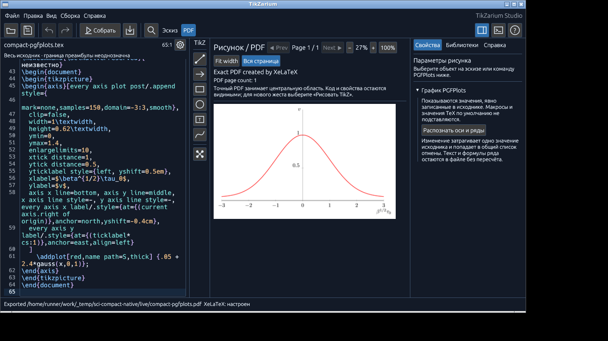
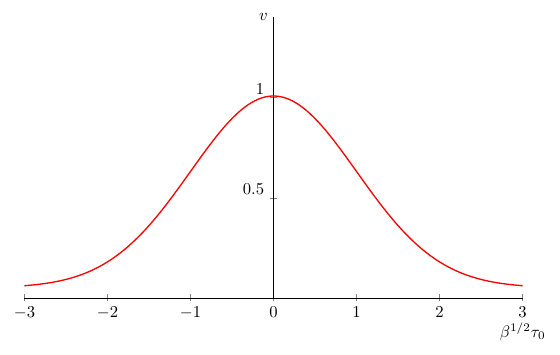

# Scientific Studio: принятый узкий HOSTED_GUI сценарий — 2026-11-13

**Сценарий SV001-derived PGFPlots → Inspector → минимальный SourcePatch → два общих Undo → побайтовый Save/Open → GUI XeLaTeX → текущий PDF успешно выполнен и независимо проверен в hosted Linux/X11.** Это принятие только перечисленных операций на указанном входе, сборке и окружении. Физический Windows10 и полный ST-SCI остаются **NO GO**.

## Точная сборка и окружение

| Объект | Идентификатор |
| --- | --- |
| [Проверенный source commit](https://github.com/i-shutov/tikzarium/commit/b646c4d46d331a281c1fe51d6bcc79c436ffdf35) | `b646c4d46d331a281c1fe51d6bcc79c436ffdf35` |
| Полное дерево | `70132efdb6147d5bbe33b38d2f825c7a6dcb5a36` |
| App source tree | `fe40516186fb1728baceb40d0da137a780c1d9de` |
| Production app SHA256 | `55c5424932f3e8581cd4ab7d2ea848bb1a398d457880074cb92bddcf2d2eaf15` |
| [Исходный Actions run](https://github.com/i-shutov/tikzarium/actions/runs/43370706180) / job | `43370706180` / `131705530398` |
| [Оригинальный artifact](https://github.com/i-shutov/tikzarium/actions/runs/43370706180/artifacts/14012741716) | `14012741716`, 109 файлов, 7 359 489 байт |
| ZIP SHA256 | `21148d1d3e755221da67fad1bbd5fd163dacd5136c8a97f6c1aa8a397a44ea2b` |
| PDF SHA256 | `c4aaa313afba9233240f07976345bd275abe3210c67f546429ec611f47deb81b` |

Одноразовый GitHub-hosted Ubuntu24.04 x86_64, Xvfb/Openbox, экран **1366×768**, app client **1180×680**, fresh-config **Midnight**. Истинное начало client по xwininfo: **(1,20)**. Production app PID5286, owned window6291459. Rust1.91.0; XeTeX0.999995, TeXLive2023/Debian. Workflow проверил exact HEAD, чистые production paths и app tree; [build receipt](assets/2026-11-13-hosted-scientific/build-provenance-original.json) содержит locked build command, source/tree/binary/Cargo.lock hashes.

Рецензент: задача `/root/sci_ci_audit_1113`; запрошенные параметры запуска, переданные интегратором: gpt-6.1-sol/high/forknone, без независимого подтверждения backend-модели. Интегратор также просмотрел оригинальные draft/Apply/оба Undo/Reopen/GUI PDF/raw-log/export PNG. Интегратор дополнительно сохранил [свою проверку байтов, provenance и исходных изображений](assets/2026-11-13-hosted-scientific/root-independent-review.json). Подробный [независимый review](assets/2026-11-13-hosted-scientific/independent-original-review.md) сохранён отдельно от исходных автоматических отчётов.

## Восемь этапов и сохранность исходника

Вход — явно подготовленная производная `roadmap/Tikzarium_Scientific_142_R4/fixtures/SR/SV-001/figure.tex`: CRLF, инертный Unicode-комментарий и неиспользуемый неизвестный макрос добавлены до GUI. Это тестовый INPUT; оригинал корпуса не изменён. Все дальнейшие source snapshots получены после реальных действий production GUI.

| Этап | Проверенный результат |
| --- | --- |
| opened | Saved source и фактический полный clipboard редактора равны исходному INPUT |
| typed | В конец вставлен один marker; source действительно сохранён через GUI |
| draft | Still-focused поле скопировало ровно151 после нового sentinel; source ещё равен typed |
| applied | Единственное изменение source: `samples=150` → `samples=151`; marker и остальные байты сохранены |
| undo-inspector | Первый общий Undo побайтово восстановил typed |
| undo-typing | Второй общий Undo побайтово восстановил исходный INPUT |
| reopened | Native Open; полный clipboard редактора и сохранённый файл равны исходному INPUT |
| built | После GUI Build/Export исходник остался равен тому же INPUT |

Минимальный patch меняет **ровно один байт** `0` → `1`; комментарии, неизвестный макрос, формула, Unicode и CRLF не переписаны. [Typed snapshot](assets/2026-11-13-hosted-scientific/typed-source-original.tex), [applied snapshot](assets/2026-11-13-hosted-scientific/applied-source-original.tex), [built snapshot](assets/2026-11-13-hosted-scientific/built-source-original.tex), [фактический151 clipboard](assets/2026-11-13-hosted-scientific/focused-draft-original.txt) скопированы без изменения байтов.

Точные source SHA256:

- Original/opened/undo-typing/reopened/built: `978ccbef1c5b61156f129d52a3ca47b0d4cff23f45c3b46cafdca2a1139c9bab`.
- Typed/draft/undo-inspector: `497a2417d43d72aa0d79de5201f2e4775243f0fc0ef5683cb637558dacebfce2`.
- Applied: `0da2421d3185430e8280c87919eb11849cc22d88452e189639d36787298cce3e`.

Новый Scan locator использовал оригинальные PNG того же run, fixed threshold144, точную бинарную glyph mask и единственный offset86. Нулевое/неоднозначное совпадение отвергается. Это ограниченный locator fresh Midnight1180×680; downstream действия дополнительно проверены clipboard/source guards и оригинальными изображениями. Маска — отдельно помеченная derived analysis; исходные PNG не изменялись.

## GUI XeLaTeX и оригинальный PDF

[Журнал native действий](assets/2026-11-13-hosted-scientific/native-actions-original.log) фиксирует Ctrl+Return в05:17:08Z, текущий GUI Export в05:17:12Z и копирование фактического GUI raw XeLaTeX log в05:17:14Z. До Export PDF отсутствовал; source hash не изменялся. [Оригинальный GUI log](assets/2026-11-13-hosted-scientific/gui-xelatex-original.log) завершён успешным выводом одной страницы; CLI-компиляция не подставлялась вместо GUI.

[Оригинальный PDF](assets/2026-11-13-hosted-scientific/compact-pgfplots-original.pdf): одна страница335.61×212.66pt,4 встроенных шрифта; [font info](assets/2026-11-13-hosted-scientific/pdffonts-original.txt), [извлечённый текст](assets/2026-11-13-hosted-scientific/pdftotext-original.txt), [engine version](assets/2026-11-13-hosted-scientific/engine-version-original.txt), [PDF info](assets/2026-11-13-hosted-scientific/pdfinfo-original.txt). Независимый локальный Poppler повторно проверил PDF; новый render560×355 пиксельно совпал с исходным retained render. Визуально подтверждены красная Gaussian curve, читаемые оси/деления и полная метка β^(1/2)τ₀ без обрезки или missing-glyph boxes.

В raw log учтены три предупреждения:

1. `shellesc`: shell escape disabled — ожидаемая политика.
2. `inputenc`: пакет игнорируется UTF8 engine — историческая преамбула fixture.
3. `polyglossia`: Russian hyphenation patterns не загружены; используется nohyphenation.

**Missing-character диагностик нет.** Видимо отрисована греческая β; кириллица здесь сохраняется в исходнике как комментарий/unused macro. Этот PDF не квалифицирует rendered Cyrillic, переносы русского текста или embedding Charis SIL.

## Оригиналы и независимый review

[Автоматический artifact audit](assets/2026-11-13-hosted-scientific/audit-report-original.json) и [driver report](assets/2026-11-13-hosted-scientific/driver-report-original.json) оставлены без изменения: их `NOT_VERIFIED`/`REQUIRES_REVIEW` фиксируют границу автоматического collector. Настоящий документ и независимый review записывают последующую проверку оригиналов; автоматические статусы не переписаны задним числом.

Проверены все99 файлов исходного audit hash ledger: **0 несовпадений**. Отобранные source/PNG/PDF/log/receipt/clipboard файлы скопированы без перекодировки. [Manifest с Git blob SHA1, SHA256 и размерами](assets/2026-11-13-hosted-scientific/manifest.json) связывает опубликованный отчёт и assets. Font binaries и toolchains не включены. Полный109-file ZIP и предыдущие попытки входят в обновляемый пакет [CP05](https://drive.google.com/open?id=1n4cvVs-un4pJRssnA6b7P9dy5dJ3l4a9).

Предыдущие attempts сохраняют свой результат:

| Exact head / run | Результат |
| --- | --- |
| cc25f815 /43367842268 | Timeout repeated-target `mousemove --sync` до typing; opened source/clipboard прошёл |
| 6b3e36e /43368808565 | Неверный Scan point свернул PGFPlots; applied source guard отклонил отсутствие patch |
| b646c4d4 /43370706180 | Успешная scoped HOSTED_GUI последовательность и независимый review оригиналов |

## Финальный Actions inventory проверенного HEAD

Полный generic API GET с `head_sha=b646c4d46d331a281c1fe51d6bcc79c436ffdf35&per_page=100&page=1`, без event filter: **total_count16, получены все16**, из них14 pull_request и2 push. Все завершены: **14 success,2 failure**. [Исходный JSON](assets/2026-11-13-hosted-scientific/exact-head-runs-final.json).

| Workflow | Event | Conclusion | Original run |
| --- | --- | --- | --- |
| B42 real Studio icon palettes screenshot audit (bootstrap only) | pull_request | success | [43370706130](https://github.com/i-shutov/tikzarium/actions/runs/43370706130) |
| N5 Linux x86_64 portable release and packaged X11 launch | pull_request | failure | [43370706203](https://github.com/i-shutov/tikzarium/actions/runs/43370706203) |
| I61 B42 real Studio icon-to-native-source/PDF (independent D QA) | pull_request | failure | [43370706368](https://github.com/i-shutov/tikzarium/actions/runs/43370706368) |
| Personal Windows Cargo and MiKTeX repair | pull_request | success | [43370706284](https://github.com/i-shutov/tikzarium/actions/runs/43370706284) |
| Scientific-142 L0 immutable corpus and negative SHA QA (not GUI) | pull_request | success | [43370706202](https://github.com/i-shutov/tikzarium/actions/runs/43370706202) |
| XeLaTeX figure fonts and glyph integrity | pull_request | success | [43370706164](https://github.com/i-shutov/tikzarium/actions/runs/43370706164) |
| SCI142 scientific Inspector / source-owning widgets | pull_request | success | [43370706194](https://github.com/i-shutov/tikzarium/actions/runs/43370706194) |
| Windows owner Administrator regression and original PDF acceptance | pull_request | success | [43370706311](https://github.com/i-shutov/tikzarium/actions/runs/43370706311) |
| N1 actual app state to TikZ to XeLaTeX | pull_request | success | [43370706364](https://github.com/i-shutov/tikzarium/actions/runs/43370706364) |
| Scientific compact Studio mixed Undo (hosted GUI, not physical Win10) | pull_request | success | [43370706180](https://github.com/i-shutov/tikzarium/actions/runs/43370706180) |
| Hosted Windows native egui HWND and F1 (not W2 or W3) | pull_request | success | [43370706215](https://github.com/i-shutov/tikzarium/actions/runs/43370706215) |
| D QA matrix - Rust and XeLaTeX | pull_request | success | [43370706352](https://github.com/i-shutov/tikzarium/actions/runs/43370706352) |
| D06 distinct MiKTeX Windows Server XeLaTeX proof | pull_request | success | [43370706309](https://github.com/i-shutov/tikzarium/actions/runs/43370706309) |
| TikZarium CI | pull_request | success | [43370706221](https://github.com/i-shutov/tikzarium/actions/runs/43370706221) |
| Scientific-142 L0 immutable corpus and negative SHA QA (not GUI) | push | success | [43370699647](https://github.com/i-shutov/tikzarium/actions/runs/43370699647) |
| TikZarium CI | push | success | [43370699718](https://github.com/i-shutov/tikzarium/actions/runs/43370699718) |

D QA matrix43370706352: **7/7 jobs success** — Rust+XeLaTeX на hosted Windows2022/Ubuntu24.04/macOS15 и independent uploaded-evidence audit. Два failure — неизменённые historical reviewed source-tree lease stops I61/N5, до GUI; exact-run failed steps проверены отдельно. Их pins не ослаблены. Другие успешные workflows сохраняют собственную узкую область corpus/unit/bootstrap/CLI/hosted-window evidence.

## Открытые обязательные gates

Не выполнены этим сценарием: физический Windows10 W0–W4, independent W2b/W3, real IME,96/120/192 DPI, native p95/first-editable-frame performance; полный SCI142/103, scientific AI88, PGFPlots SC3/AT4 aggregate, Asymptote, Typst/CeTZ и весь release contract ST-SCI. Их прежние MUST и status не меняются. Stable version/tag, merge/release GO и общее принятие Studio не следуют из этого результата.

Следующая исполнимая работа: проверенная адаптация I61 и N5 к текущей компактной раскладке и повторное выполнение их собственных полных сценариев с оригинальными свидетельствами. Обновление source-tree leases должно сопровождать эту адаптацию; один startup или данный SV-001 не закрывают шесть примитивов, library/parameter contracts и packaged launch. Квалификация физического Windows10 и остальные научные release-contract операции сохраняют собственные обязательные планы. Новая документационная публикация не переносит этот hosted результат на другой app tree или другую платформу.
