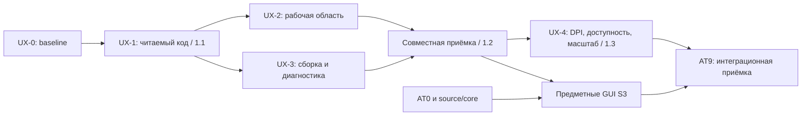

# UX-ветка TikZarium: релизный план

## Последнее решение владельца — UIX в 1.0, не после него

**10.11.2026 владелец отменил прежнюю отсрочку:** «нет, тащи их в 1.0. делай мердж и веди разработку». **UX-0…UX-4 и все 14 UX-F01…F14 входят в обязательный Windows 1.0 scope**, до массового расширения палитры/Inspector предметными пакетами. Новый [нормативный release-план](WINDOWS_1_0_UIX_OWNER_OVERRIDE_20261110_RU.md) имеет приоритет перед прежними оценками 1.1/1.2/1.3 ниже; они сохраняются только как историческое предложение и список подробных требований G1–G3/T0–T8. Исправления не считаются выполненными от факта переноса или появления этого раздела.

**DPI:** т.к. владелец перенёс *все* UIX задачи в 1.0, прежняя отсрочка физического 125%/200% из #161 больше не действует для этой версии; вместе с 96% требуется оригинальная Win10 DPI/мониторная приёмка. W2b, реальный IME composition, W4, MiKTeX safety и условия stable остаются. 35 специализированных TeX расширений и 88 GUI-адаптеров в 1.0 не входят.

Дата: **10 ноября 2026**. Основание: [критический UX-аудит](../insights/2026-11-10_CRITICAL_UX_AUDIT_RU.md), свежий main `bd0b698503648f43a1db9d1810466ec5d1c18ecd`, запрос владельца на эргономичный интерфейс и **код с подсветкой**.

**Статус:** план записан; реализация UX-1…UX-4 **PLANNED / NOT_IMPLEMENTED**. UX-0 имеет исходный аудит и ограниченный живой осмотр, но ещё не пользовательские измерения. Номера 1.1/1.2/1.3 ниже — предлагаемые продуктовые вехи после 1.0, не существующие теги, обещанные даты или разрешение публикации.

## 1. Положение относительно остальных веток

- **Windows 1.0** продолжает действующую заморозку и [release control](../docs/WINDOWS_1_0_RELEASE_CONTROL_RU.md). UX-план не меняет W2b, IME, W4, exact-source provenance и решение о 96 DPI. UX можно разрабатывать в изолированной feature-ветке сейчас; не подмешивать её код в frozen candidate автоматически.
- **UX** — самостоятельная продуктовая ветка с ранними поставками. Полноценная подсветка выпускается в первой поставке UX-1, а не после всех предметных пакетов.
- **AT0–AT9 / 88 examples** сохраняются полностью. AT0 intake, source/build и предметные core-адаптеры могут идти независимо. Общий редактор из UX-1 и shell/inspector-контракт UX-2/3 используются до массовой приёмки S3. AT9 подтверждает интеграцию; он больше не единственное место, где оценивается UX.
- **Scientific-142 R4** сохраняет независимую source/научную/визуальную матрицу; UX не переписывает исходные fixtures и не закрывает L3/S3 одним цветным кодом.

Граф задаёт зависимости продукта, не требование запускать агентов. Календарные сроки определяются после UX-1 по фактическому объёму и измерениям; PR-count не заменяет оценку трудозатрат.

## 2. Вехи и условия выпуска

| Блок / кандидат | Пользовательский результат | Обязательный состав | Gate | Ответственные роли | Статус |
| --- | --- | --- | --- | --- | --- |
| **UX-0 — baseline** | Проверяемый список проблем и исходная точка сравнения | Аудит UX-F01…F14, оригиналы/хеши, версия EXE, задачи пилота; сверка PR #128 | Материалы воспроизводимы; ограничения отдельно; исходные пользовательские времена ещё измерить | B + D, integrator | **PARTIAL**: аудит/живой осмотр DONE; user timing NOT_RUN |
| **UX-1 — 1.1 «Читаемый код»** | Пользователь читает, ищет и исправляет TeX в реальном редакторе | Синтаксическая подсветка, gutter, текущая строка, Find/Replace, Go to line, размер шрифта, metadata styling, wrap без смены байтов | G1 integrity + G2 native editor + G3 performance + задачи T1/T2/T5; отсутствие подсветки блокирует выпуск | B editor, C lexical/catalogue, A source/Undo, D QA | **PLANNED** |
| **UX-2 — часть 1.2 «Рабочая область»** | Пользователь находит инструмент и свойства без обхода служебных экранов | Основные инструменты в один выбор, компактный Inspector, один Apply, осмысленные режимы/пустые состояния, единые подписи, resize/focus/reset | Задачи T3/T4; нулевое перекрытие основных действий на матрице viewport; source/PDF соответствуют обещанному режиму | B + C; A shared state; D native QA | **PLANNED** |
| **UX-3 — часть 1.2 «От правки к PDF»** | Первая сборка и исправление ошибки понятны без инструкции | Save & Build picker/fallback, disabled reason, состояния build/stale/error, click-to-source, понятный export, локализованная диагностика | T0/T5/T6/T7 + отмена сборки/диалога, last-good, Save/Open и повторная правка; UX-2 и UX-3 принимаются вместе | A + B, C текст, D failure flows | **PLANNED** |
| **UX-4 — 1.3 «Масштаб и доступность»** | Длинные проекты и дополнительные DPI остаются удобными | 125%/200% из #161, keyboard/accessibility, большие документы, Figure Explorer integration и навигация 88-case | Физическая приёмка заявленных DPI/платформ, T8, performance budget; отдельная AT/Scientific ведомость | B + A + C, D physical/independent review | **PLANNED** |

Для каждой вехи: `alpha.1` с работающей вертикалью → `rc.1` после целевых регрессий и визуального ревью → stable только после критериев вехи и платформенной приёмки. Нельзя выпускать «UX 1.1» как одну смену цветов без работающего редактирования/навигации. При необходимости небольшой defect-only hotfix 1.0.x проходит собственный release scope и не объявляется завершением UX-1.

## 3. UX-1: обязательный редактор с подсветкой

### Реализационные задачи

1. **UX-1.1 / F01,F02.** Перенести полезную presentation-only основу [PR #128](https://github.com/i-shutov/tikzarium/pull/128) после разрешения конфликтов с текущим main. `source_presentation` расширить до небольшого детерминированного TeX/TikZ lexer; форматирование рендеринга не должно выдавать права на source patch. Семантические справочники брать у C, неизвестный макрос оставлять допустимым текстом.
2. **UX-1.2 / F01.** Палитры для Light/Dark/Midnight/Paper: команды, комментарии, группы/опции, числа/единицы, поддержанные TikZ-операторы, math delimiters/окружения. Поддержанный scope лексера и fallback для `catcode`/opaque описаны явно. Различать синтаксическую окраску, active line, selection, diagnostic и search match. [Подробный контракт](../insights/2026-11-10_CRITICAL_UX_AUDIT_RU.md#5-что-означает-обязательная-подсветка-кода).
3. **UX-1.3 / F02.** Приглушить только распознанный служебный комментарий, сохранив читаемость. Не скрывать содержимое и не переписывать JSON; marker внутри `\verb`, escaped `%` и пользовательского текста не считать ownership. No-wrap для нового профиля оценить на T1; существующий выбор пользователя сохранять. Доступный переключатель wrap обязателен в обоих режимах.
4. **UX-1.4 / F03.** Gutter физических строк, current line и строка/столбец курсора. Номер выводится один раз на физическую строку, continuation rows не получают новых номеров. Diagnostic jump и F1 используют исходные индексы, не визуальную строку.
5. **UX-1.5 / F03.** Find `Ctrl+F`, следующий/предыдущий результат, счётчик, Escape с возвратом focus; Go to line `Ctrl+G`. Literal Replace с preview количества совпадений, только по явному действию; Replace All — одна undoable transaction с проверкой ревизии. Regex и project-wide search не обязательны для 1.1.
6. **UX-1.6 / F12.** Независимый размер шрифта кода 12–24 pt с сохранением и сбросом. Это GUI-настройка, не fontspec рисунка. Кэш token spans по source revision; layout переиспользуется где возможно, инвалидируется по wrap/font/theme/width. Не блокировать основной ввод фоновым устаревшим результатом.

### Gate G1 — источник остаётся источником

- Exact byte round-trip без правок для UTF-8/кириллицы/emoji/combining characters, LF и CRLF, табов, пустого документа, файла без конечного newline, комментариев и неизвестных макросов.
- Раскраска всех token spans в валидных UTF-8 границах; `LayoutJob.text == source` побайтно. Проверить escaped `%`, два backslash перед `%`, незакрытые `{`/`$`, multiline math, `\verb`, verbatim и marker-lookalike.
- Edit → Undo/Redo, GUI insert → jump → text edit → Undo, Apply → Undo, Save/Open с переходом между документами; старые native Undo snapshots не возвращают чужой документ.
- Copy/paste и Find/Replace работают с буквальным исходником, не с очищенной презентацией. Замена по устаревшей ревизии отвергается. Включение темы/wrap/шрифта не делает документ dirty и не запускает TeX.

### Gate G2 — реальный редактор, а не картинка

Исходник с 6 primitives и длинным JSON, пользовательский TikZ без markers и PGFPlots source должны редактироваться в GUI. Оригинальные PNG до/после на light/dark и compact viewport; ручной ввод, selection поверх окраски, мышь/клавиатура, перенос, F1 и переход по ошибке. Приёмка desktop отдельно от unit-event. Модель API `LayoutJob` не требует миграции на web editor, LSP или полного TeX parser.

### Gate G3 — измеряемая производительность

Новые **целевые бюджеты**, пока не измеренные: на фиксированной QA Win10-машине, с записанными CPU/RAM/renderer/source SHA, документ 10 000 строк / до 1 MiB: p95 от native key event до отображённого кадра ≤50 ms, открытие до редактируемого кадра ≤2 s; ни одного полного lexer pass на idle-frame без invalidation. Отдельный stress 100 000 строк / до 10 MiB: отсутствие зависания, потери ввода или повреждения; длительная подготовка должна оставлять отзывчивый UI. CPU/GPU/диск и cold/warm состояние записываются, цифры не переносятся между Mesa RDP и normal GPU без измерения. Превышение бюджета требует исправления либо конкретного ограничения в scope перед RC, не фиктивного PASS.

## 4. UX-2: структура рабочего пространства

**Целевая иерархия:** документ и основные действия сверху; редактируемый код слева; эскиз/PDF в центре; контекстные свойства справа; ошибки снизу по необходимости. Код + центральная область — стандартный режим; code-only и canvas-only остаются осознанными focus views.

| Область | Изменение | Приёмка |
| --- | --- | --- |
| Главные действия | Подписанная primary-кнопка «Собрать PDF», краткие «Открыть», «Сохранить», «Экспорт»; редкие команды в меню | Доступность каждого действия отражает реальную возможность; причина блокировки видна/доступна с клавиатуры |
| Инструменты | 6 primitives доступны одним выбором в компактной панели; единая логика line/arrow, активный инструмент явно назван | Нет необходимости открыть группу для каждой базовой команды; палитра не закрывает место жеста |
| Inspector | Русская подпись + единицы, поля x/y группируются, длинные пояснения по `i`/F1; один закреплённый Apply/Undo | Для line/rectangle/circle основные поля и Apply видны без прокрутки на минимальном viewport; Bézier имеет ясные группы точек |
| Context help | Одна карточка context; справка/пример/manual остаются доступны, но не дублируются сверху и в теле | Открытие F1 не меняет TeX, не теряет выбранный объект и возвращает focus при закрытии |
| Библиотеки | Пять состояний сохраняются, подаются краткими русскими метками и раскрываемыми подробностями | UNKNOWN не становится ложным «нет»; Connect показывает source diff и Undo; lookup package/help не требует изучать debug-реестр |
| Эскиз/PDF | Ясная подпись возможностей каждого режима, объяснение пустого эскиза при существующем исходнике; явный action сборки | Пользователь различает provisional sketch и authoritative PDF; интерфейс не обещает PDF→source mapping |
| Layout | Resize, удобные стартовые пропорции, сохранение и «Сбросить расположение», focus views | Стандартный split сохраняет доступ к коду и центру; нет закрытых toolbar/Apply/status и внеэкранных popup |

Матрица viewport для UX-1/2/3 при **96 DPI**: клиент 1180×680 (историческая база), 1366×768, 1920×1080; отдельно стресс на 1024×640 с объявленным compact/focus поведением. Это размеры клиентской области, не разрешение монитора. Если split не помещается, предложить явное компактное представление; нельзя молча скрывать единственный editable source. Новые 125%/200% обязательства начинаются в UX-4 и не блокируют замороженный 1.0.

## 5. UX-3: первая сборка, ошибки и состояния

1. **F05:** Save & Build предлагает native picker и редактируемый путь, понятное имя нового `.tex`; RDP fallback остаётся внутри окна. Отмена не создаёт файл, не запускает TeX и не теряет документ. Существующий посторонний файл не перезаписывается молча.
2. **F09/F11:** заменить зависимость интерфейса от произвольного текста `self.status` на небольшой типизированный state/command contract. Примеры: документ clean/dirty; build idle/running/cancelled/failed/succeeded; PDF absent/current/stale. Хранить source revision, к которой относится результат, и понятный timestamp/duration. Не строить глобальную новую state-machine framework ради нескольких статусов.
3. **F10/F11:** русский основной текст «Сборка», «Ошибки», «Журнал XeLaTeX», «Страница», «По ширине»; полные пути/versions/debug — в подробностях и копировании. Отделить warnings от errors; MiKTeX update warning при успешном PDF не обозначать как неуспешную сборку.
4. **F03/F11:** ошибка показывает понятную сводку, файл и строку; переход точный, неизвестный source не угадывается. После исправления новый результат снимает только соответствующий stale/error; журнал последнего запуска доступен.
5. **F09/F11:** во время компиляции видны progress/Cancel; повторный Build не создаёт конкурирующих workers. При ошибке сохраняется last-good PDF с явной меткой «Устарел». Export текущего результата — явная доступная команда, устаревший не выдаётся за актуальный.
6. **F04:** onboarding ограничить одним полезным действием и проверкой готовности TeX; не заставлять читать устройство adapters. Compile только по явному запросу, внешний XeLaTeX, без скрытой установки пакетов или смены engine.

Приёмка 1.2 объединяет UX-2 и UX-3: новый файл → фигура → свойства → код → сохранение → PDF → намеренная ошибка → исправление → экспорт → повторное открытие. Нельзя принять layout отдельно, если пользовательский цикл остался разорван.

## 6. UX-4: масштабирование без размножения старых проблем

- Закрыть [#161](https://github.com/i-shutov/tikzarium/issues/161) по физическим 120/192 DPI: корректные bounds, шрифты, hit targets, popup, source jump и F1; зафиксировать смену DPI/монитора и возвращение к 96. Скриншот, увеличенный программно, не является этим тестом.
- Семантические имена и роли кастомных кнопок, Tab/Shift+Tab, Enter/Space, явный focus, Escape, shortcuts без перехвата обычного ввода. Проверить screen reader, а не только наличие атрибута в коде. Базовые focus/labels не откладывать: добавлять уже при реализации UX-1/2.
- IME composition/preedit проверяется отдельно от русской раскладки; требования текущего 1.0 по IME не переносятся этим пунктом автоматически.
- Подключить Figure Explorer к AT7: поиск/фильтры → пример → исходник → требования → PDF. Не создавать 88 ручных экранов; применить общий editor/inspector/help contract. AT0 ledger и source artifacts — зависимости, не подменять недоставленные данные выдуманным атласом.
- Recheck больших документов и холодного старта; folding metadata может войти только отдельным принятым sub-scope после source↔view mapping/Undo/copy тестов. Оно не условие появления подсветки.
- Windows/macOS/Linux CI сохраняется. Поддержка физического macOS/Linux/Win11 объявляется только после отдельной платформенной приёмки, не на основании Win10 screenshots.

## 7. Пользовательские задачи и метрики

Предлагаемый первый пилот: **5 человек**, включая автора TikZ, пользователя научных рисунков без опыта TikZarium и новичка. Это небольшой formative-тест, не статистическая оценка рынка. Один неизменный набор задач, заранее подготовленная TeX-среда, без подсказок экспериментатора. Время включает взаимодействие; время внешней компиляции записывается отдельно. Предыдущая знакомость с приложением фиксируется.

| ID | Задача | Целевой результат к выпуску |
| --- | --- | --- |
| T0 | Открыть новый пример, выбрать место сохранения и получить первый PDF | ≥4/5 выполняют без подсказки; median interaction time ≤120 s, без ручного набора полного пути в нормальном picker-сценарии |
| T1 | Найти и изменить цвет/число среди 6 команд с metadata | ≥4/5 ≤60 s; без правки служебного JSON и без необходимости выключать обязательную подсветку |
| T2 | Найти текст, перейти к строке, заменить одно совпадение, Undo | 5/5 сохраняют правильный фрагмент; нет изменения остальных байтов; навигация работает с wrap on/off |
| T3 | Найти circle и Bézier, создать объект | Базовый tool выбирается одним нажатием; ≥4/5 находят каждый ≤10 s, жест отдельно от времени поиска |
| T4 | Выбрать созданную фигуру, изменить радиус/координату, Apply, Undo | ≥4/5 понимают draft vs applied; Undo возвращает исходный SHA; переключение F1 не уничтожает draft |
| T5 | Исправить намеренную TeX-ошибку через диагностику | ≥4/5 находят нужную строку ≤30 s после появления ошибки; после Build видно актуальное состояние PDF |
| T6 | После изменения/ошибки определить, актуален ли показанный PDF | 5/5 правильно различают current/stale; ноль ошибочных экспортов, выданных за текущий результат |
| T7 | Отменить Save & Build и длительную компиляцию | UI остаётся доступным; нет неожиданного файла/пакетной установки/потери документа; bounded child termination соответствует core contract |
| T8 | Найти заданный пример в 88-case Explorer и открыть исходник | ≥4/5 без знания имени файла; отображены правильные engine/package requirements и статус данных |

Все числа — **заданные цели, NOT_MEASURED**, не результаты текущего аудита. UX-0 дополняется исходными временами на текущем интерфейсе перед сравнением. Фиксировать success, время, ошибочные клики, возвраты, потребность в помощи и субъективную причину затруднения. Не заменять провал ключевого задания средней оценкой «нравится дизайн».

## 8. Поставка, проверки и откат

Для каждого release candidate обязательны:

1. Точный source SHA/Cargo.lock/binary manifest и понятный список закрытых UX-Fxx. У CI и осматриваемого приложения одна заявленная версия; исторический PNG не доказывает новый кандидат.
2. Targeted Rust/editor/source-patch tests, существующие Undo/Save/Open/compile regressions и hosted GUI. Полную дорогую матрицу не повторять после каждого документа; выполнять на готовом функциональном срезе и после существенной правки.
3. Native GUI задачи соответствующей вехи на реальной Windows10; original owned-client PNG, source before/after/Undo, PDF/log для сценариев сборки. В Codex при проблеме Sky использовать разрешённый внешний worker на `WinSta0/Default` по [отчёту контекста](https://github.com/i-shutov/tikzarium/blob/b8eb2ff70c830371d6b02524eb42628402c39d1b/docs/WINDOWS_10_W3_CODEX_DESKTOP_CONTEXT_RU.md): проверить контекст, PID/session/foreground, не повторять capture из неправильного desktop.
4. Независимый visual/source-integrity review и task pilot. При layout-only изменении PDF должен быть семантически тем же; не требовать byte-identical PDF при изменяющихся служебных timestamp компилятора, но исходник до/после styling обязан совпадать побайтно.
5. Known issues, unsupported contexts, актуальные screenshots/guide и release notes. Никакого P0; незакрытые P1 своей вехи блокируют RC→stable. Планы более поздней вехи не считаются её выполнением.
6. Additive preferences schema с безопасным чтением старых настроек, сохранённый выбор wrap/theme; обычный `.tex` остаётся открываемым прежней версией. Откат — предыдущий проверенный portable + копия preferences; не мигрировать исходники автоматически.

Минимальный evidence record: `UX-ID / source SHA / EXE SHA / OS / DPI / client rect / renderer / task / original files+SHA / SOURCE / GUI / PERF / USER_TASK / reviewer decision`. Допустимые состояния: `PLANNED`, `IMPLEMENTED_NOT_VERIFIED`, `UNIT_EVENT_PASS`, `HOSTED_GUI_PASS`, `PHYSICAL_PASS`, `NOT_RUN`, `FAIL`. Нельзя сводить их к одной зелёной галочке.

## 9. Ближайший конкретный implementation slice

**Первым брать UX-1.1…UX-1.3: настоящий токенизированный editable source, 4 темы, metadata styling и source-integrity/Undo/native-редактирование.** Использовать PR #128 как материал для интеграции, не вливать конфликтующий draft автоматически и не выдавать dimming за завершённую подсветку. Затем в той же релизной вехе довести gutter, поиск/замену, Go to line, размер кода и G1–G3 до RC.

Обновлять этот файл и [insights](../insights/2026-11-10_CRITICAL_UX_AUDIT_RU.md) только по реально закрытым критериям. Публикация данного плана сама по себе не закрывает ни одной функции UX-1…UX-4.
